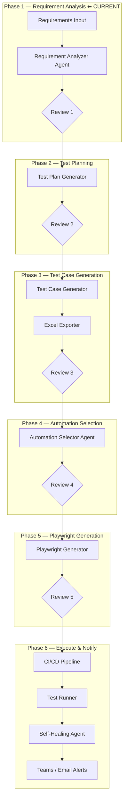

# AI QA Daily Agent — Master Plan

> **Living document** — update this file as phases are designed, built, and reviewed.  
> **Repository:** [ai-qa-automation](https://github.com/)  
> **Last updated:** 2026-08-07  
> **Current focus:** Phase 1 — Requirement Analysis

---

## 1. Vision

Build a **Daily QA Agent** that handles end-to-end QA work while the QA engineer **monitors and approves** at review checkpoints — not a black-box replacement for human judgment.

### Goals

| Goal | Description |
|------|-------------|
| **Automate repetitive QA work** | Analysis, test planning, test case writing, automation selection, script generation |
| **Keep human in control** | Review and approve at every major phase |
| **Produce usable artifacts** | Excel test cases, Playwright scripts, CI reports, Teams/email alerts |
| **Improve over time** | Use epic context, repeat bugs, and run history to prioritize automation |
| **Self-heal where safe** | Fix locator/UI drift; escalate real failures for human review |

### Operating Model

```text
AI drafts → Review checkpoint → Human approves/edits → Next phase
```

The QA engineer's role shifts from **doing everything manually** to **monitoring, reviewing, and deciding**.

---

## 2. End-to-End Pipeline



### Review Checkpoints Summary

| # | After | Reviewer checks | Actions |
|---|-------|-----------------|---------|
| **1** | Requirement analysis | Modules, flows, auth, gaps | Approve / Edit / Regenerate |
| **2** | Test plan | Scope, risks, in/out of scope | Approve / Edit / Regenerate |
| **3** | Test cases + Excel | Coverage, steps, priorities | Approve / Edit / Regenerate |
| **4** | Automation selection | Must/should/skip list + reasons | Approve / Edit / Regenerate |
| **5** | Playwright scripts | Critical flows, locators, assertions | Approve / Edit / Regenerate |
| **6** | CI run + self-heal | Unhealed failures, report | Triage / Fix / Accept |

---

## 3. Phase Status Tracker

| Phase | Name | Status | Doc section | Code |
|-------|------|--------|-------------|------|
| **1** | Requirement Analysis | 🟡 In progress | [§4](#4-phase-1--requirement-analysis-current-focus) | Partial — `agents/moduleAnalyzer.js` |
| **2** | Test Planning | ⚪ Not started | [§5.1](#51-phase-2--test-planning) | — |
| **3** | Test Case Generation + Excel | 🟡 Partial | [§5.2](#52-phase-3--test-case-generation--excel) | Partial — `agents/testGenerator.js` |
| **4** | Automation Selection | ⚪ Not started | [§5.3](#53-phase-4--automation-selection) | — |
| **5** | Playwright Generation | ⚪ Not started | [§5.4](#54-phase-5--playwright-generation) | — |
| **6** | CI/CD + Self-Heal + Alerts | ⚪ Not started | [§5.5](#55-phase-6--cicd-execution--self-healing--alerts) | — |
| **—** | Orchestrator + Review workflow | ⚪ Not started | [§6](#6-orchestrator--review-workflow) | Partial — `index.js` |

**Legend:** 🟢 Done · 🟡 In progress / partial · ⚪ Not started · 🔴 Blocked

---

## 4. Phase 1 — Requirement Analysis (Current Focus)

> **This is the most crucial phase.** Everything downstream — test plan, test cases, automation, Playwright — depends on accurate requirement understanding.

### 4.1 Purpose

Transform raw requirements (text, docx, and later Jira/Confluence) into a **structured, validated understanding** of the application: authentication, modules, submodules, flows, and classifications (Positive / Negative / Edge).

### 4.2 Inputs

| Input | Status | Notes |
|-------|--------|-------|
| Plain text file (`input.txt`) | ✅ Supported | Via `utils/inputProcessor.js` |
| Word document (`.docx`) | ✅ Supported | Via `mammoth` |
| PDF | ⚪ Planned | — |
| Jira epic / Confluence | ⚪ Planned | API integration |
| Multiple files per run | ⚪ Planned | — |

### 4.3 Outputs

**Primary artifact:** `moduleData.json` (or versioned under `runs/<run-id>/`)

```json
{
  "metadata": {
    "runId": "",
    "analyzedAt": "",
    "sourceType": "text | docx",
    "sourceFile": "",
    "applicationName": "",
    "applicationUrl": ""
  },
  "authentication": {
    "required": true,
    "type": "UI | API",
    "steps": []
  },
  "modules": [
    {
      "name": "",
      "type": "Functional",
      "description": "",
      "submodules": [
        {
          "name": "",
          "category": "Positive | Negative | Edge",
          "description": "",
          "requirementRef": ""
        }
      ]
    }
  ],
  "gaps": [],
  "assumptions": [],
  "outOfScope": []
}
```

**Human-facing artifact (planned):** Requirement analysis summary (Markdown or PDF) for Review 1.

### 4.4 What Exists Today

| Item | File | Gap |
|------|------|-----|
| Basic module analyzer | `agents/moduleAnalyzer.js` | No metadata, gaps, assumptions |
| Input loader | `utils/inputProcessor.js` | Hardcoded paths |
| OpenAI client | `config/openai.js` | Single provider only |
| Pipeline step | `index.js` | No review gate, no run folders |
| Sample output | `moduleData.json` | Mostly Positive submodules; no Negative/Edge depth |

### 4.5 What We Will Build (Phase 1 scope)

#### Must have (MVP)

- [ ] **Structured output schema** — metadata, gaps, assumptions, requirement refs
- [ ] **Improved analyzer prompt** — enforce Positive / Negative / Edge per module
- [ ] **Application context extraction** — name, URL from requirements (not hardcoded)
- [ ] **JSON schema validation** — reject/fix malformed LLM output
- [ ] **Retry logic** — on API failure or invalid JSON
- [ ] **Run folder structure** — `runs/<timestamp-runId>/moduleData.json`
- [ ] **Analysis summary report** — readable summary for Review 1
- [ ] **Review checkpoint #1** — approve before test plan phase

#### Should have

- [ ] CLI args — `--input=text`, `--file=input.txt`
- [ ] Config file — `config/agent.config.json`
- [ ] Prompt externalized — `prompts/requirementAnalyzer.md`
- [ ] Traceability — map submodule → requirement line/section

#### Could have (later)

- [ ] Jira/Confluence ingestion
- [ ] Multi-document merge (epic + stories)
- [ ] Comparison with previous analysis (diff)
- [ ] Second-pass "critic" agent to validate analysis

### 4.6 Agent Design

```text
Requirement Analyzer Agent
├── Input: raw requirement text
├── Context: optional epic ID, app name, prior bug areas
├── Process:
│   1. Extract application metadata (name, URL, env)
│   2. Identify authentication (required, type, steps)
│   3. Identify modules and user flows (submodules)
│   4. Classify each flow: Positive / Negative / Edge
│   5. Flag gaps, ambiguities, assumptions
│   6. Validate output against JSON schema
└── Output: moduleData.json + analysis-summary.md
```

### 4.7 Acceptance Criteria (Phase 1 complete when…)

1. Given `input.txt` (SauceDemo sample), agent produces valid `moduleData.json` with metadata.
2. Each module has at least one Positive, Negative, and Edge submodule where applicable.
3. Gaps and assumptions are listed when requirements are ambiguous.
4. Invalid LLM JSON triggers retry (up to N times) or clear error.
5. Analysis summary is generated for human review.
6. Pipeline **pauses** at Review 1 until approved (manual flag or CLI for now).
7. README and this doc reflect Phase 1 behavior.

### 4.8 Review Checkpoint #1 — Checklist

Use this when reviewing analyzer output:

- [ ] Application name and URL are correct
- [ ] Authentication is correctly identified (or marked not required)
- [ ] All major modules from requirements are present
- [ ] No invented modules or flows not in requirements
- [ ] Submodules cover Positive, Negative, and Edge where relevant
- [ ] Gaps and assumptions are reasonable
- [ ] Ready to proceed to test plan generation

### 4.9 Phase 1 — Detailed Design Notes

> **Placeholder** — add in-depth design here as we refine (prompts, examples, edge cases, Jira format, etc.)

```text
[Your in-depth Phase 1 notes go here]
```

---

## 5. Future Phases (Summary)

> Detailed design for each phase will be added in separate sections or linked docs as we reach them.

### 5.1 Phase 2 — Test Planning

**Purpose:** Produce a test plan document before detailed test cases.

**Outputs:** Scope, objectives, test types, risks, in/out of scope, module-wise strategy.

**Review:** Checkpoint #2.

**Detailed design:** _TBD_

---

### 5.2 Phase 3 — Test Case Generation + Excel

**Purpose:** Generate enterprise test cases and export to Excel.

**Outputs:** `testCases.json`, `testCases.xlsx` (columns: ID, title, steps, expected, priority, tags, automation flag).

**Builds on:** Phase 1 `moduleData.json`.

**Review:** Checkpoint #3.

**Detailed design:** _TBD_

---

### 5.3 Phase 4 — Automation Selection

**Purpose:** AI selects which test cases to automate using:

- Epic / requirement critical areas
- Repeated bugs (Jira/Azure DevOps when available)
- Regression risk and automation feasibility

**Outputs:** Ranked list — `must_automate` | `should_automate` | `skip` + reason per case.

**Review:** Checkpoint #4.

**Detailed design:** _TBD_

---

### 5.4 Phase 5 — Playwright Generation

**Purpose:** Generate executable Playwright tests + Page Objects from approved automation list.

**Outputs:** `playwright/tests/`, `playwright/pages/`, config.

**Review:** Checkpoint #5.

**Detailed design:** _TBD_

---

### 5.5 Phase 6 — CI/CD, Execution, Self-Healing, Alerts

**Purpose:** Run automation in CI/CD; notify on failure via MS Teams and email; self-heal locators where safe.

**Triggers:** PR, nightly schedule, post-approval webhook.

**Self-heal scope:** Locators/selectors only — not business logic or expected results without review.

**Review:** Checkpoint #6 for unhealed failures.

**Detailed design:** _TBD_

---

## 6. Orchestrator & Review Workflow

**Planned component:** `orchestrator/dailyAgent.js`

Responsibilities:

- Run phases in order
- Persist state per run under `runs/<run-id>/`
- Enforce review gates (pause until approved)
- Log phase inputs/outputs for audit

**Run folder structure (planned):**

```text
runs/
└── 2026-08-07_143022_a1b2c3/
    ├── config.json
    ├── input/
    │   └── requirement.txt
    ├── phase1-requirement-analysis/
    │   ├── moduleData.json
    │   ├── analysis-summary.md
    │   └── review.json          # approved | rejected | pending
    ├── phase2-test-plan/
    ├── phase3-test-cases/
    ├── phase4-automation-selection/
    ├── phase5-playwright/
    └── phase6-execution/
```

**Review state (`review.json`):**

```json
{
  "phase": "requirement-analysis",
  "status": "pending | approved | rejected",
  "reviewedBy": "",
  "reviewedAt": "",
  "comments": ""
}
```

---

## 7. Technology Stack

| Layer | Choice | Notes |
|-------|--------|-------|
| Runtime | Node.js (ESM) | Current |
| LLM | OpenAI (`gpt-4o-mini` / configurable) | Current |
| Input | txt, docx (`mammoth`) | Current |
| Excel | `exceljs` or `xlsx` | Planned |
| Automation | Playwright | Planned |
| CI/CD | GitHub Actions or Azure DevOps | Planned |
| Alerts | MS Teams webhook, email (SendGrid/SMTP) | Planned |
| Validation | JSON Schema (`ajv`) | Planned Phase 1 |

---

## 8. Repository Structure

### Current

```text
ai-qa-automation/
├── agents/
│   ├── moduleAnalyzer.js      # Phase 1 (partial)
│   └── testGenerator.js       # Phase 3 (partial)
├── config/
│   └── openai.js
├── utils/
│   └── inputProcessor.js
├── docs/
│   └── AI_QA_AGENT_PLAN.md    # This file
├── index.js
├── input.txt
├── package.json
└── README.md
```

### Planned

```text
ai-qa-automation/
├── agents/
│   ├── requirementAnalyzer.js   # Phase 1 (renamed/enhanced)
│   ├── testPlanGenerator.js     # Phase 2
│   ├── testCaseGenerator.js     # Phase 3
│   ├── automationSelector.js    # Phase 4
│   ├── playwrightGenerator.js   # Phase 5
│   └── selfHealingAgent.js      # Phase 6
├── orchestrator/
│   └── dailyAgent.js
├── prompts/
│   └── requirementAnalyzer.md
├── schemas/
│   └── moduleData.schema.json
├── exporters/
│   └── excelExporter.js
├── playwright/
│   ├── tests/
│   └── pages/
├── runs/                          # gitignored run artifacts
├── .github/workflows/
│   └── playwright.yml
└── docs/
    └── AI_QA_AGENT_PLAN.md
```

---

## 9. Implementation Roadmap

| Order | Work item | Depends on |
|-------|-----------|------------|
| **1** | Phase 1 — Requirement analysis (full MVP) | — |
| **2** | Review workflow + run folders | Phase 1 |
| **3** | Phase 2 — Test plan generator | Phase 1 approved |
| **4** | Phase 3 — Test cases + Excel | Phase 2 approved |
| **5** | Phase 4 — Automation selection | Phase 3 + optional bug data |
| **6** | Phase 5 — Playwright generation | Phase 4 approved |
| **7** | Phase 6 — CI/CD + alerts + self-heal | Phase 5 approved |

---

## 10. Changelog (this document)

| Date | Author | Change |
|------|--------|--------|
| 2026-08-07 | — | Initial master plan created; Phase 1 scoped as current focus |

---

## 11. How to Use This Document

1. **Before starting a phase** — read the phase section; fill in "Detailed design" placeholders.
2. **While building** — update checkboxes in §4.5 and status in §3.
3. **After review** — note decisions in §4.9 or phase-specific sections.
4. **On GitHub** — commit updates with the phase name in the message, e.g. `docs: update Phase 1 requirement analysis design`.

---

## 12. Related Files

| File | Purpose |
|------|---------|
| `README.md` | Quick start and installation |
| `docs/AI_QA_AGENT_PLAN.md` | This master plan |
| `agents/moduleAnalyzer.js` | Current Phase 1 implementation |
| `input.txt` | Sample requirements (SauceDemo) |
