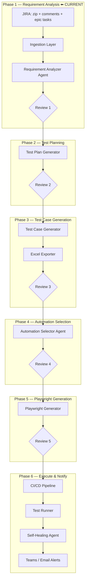
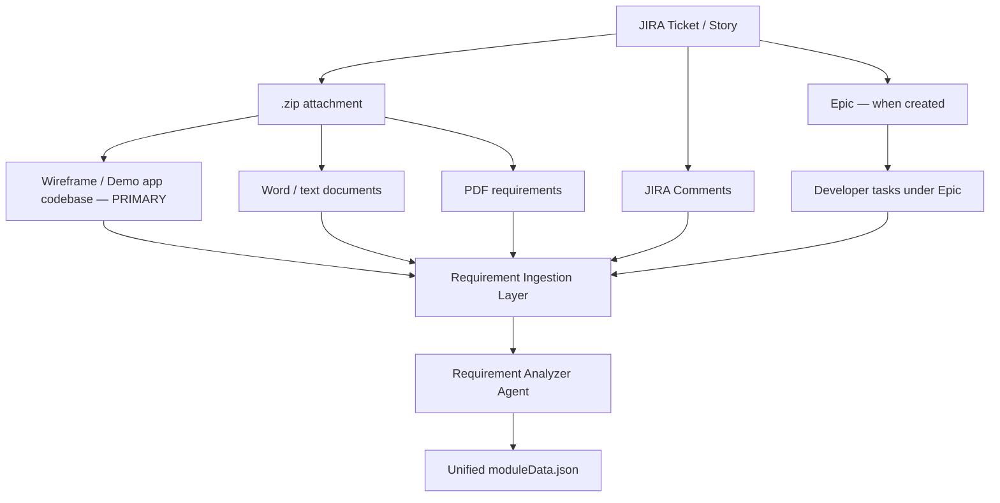

# AI QA Daily Agent — Master Plan

> **Living document** — update this file as phases are designed, built, and reviewed.  
> **Repository:** [ai-qa-automation](https://github.com/)  
> **Last updated:** 2026-08-07 (Phase 1 study/local mode implemented)  
> **Current focus:** Phase 1 — Requirement Analysis (local mock bundle, no real JIRA)

---

## 1. Vision

Build a **Daily QA Agent** that handles end-to-end QA work while the QA engineer **monitors and approves** at review checkpoints — not a black-box replacement for human judgment.

### Goals

| Goal | Description |
|------|-------------|
| **Automate repetitive QA work** | Analysis, test planning, test case writing, automation selection, script generation |
| **Keep human in control** | Review and approve at every major phase |
| **Produce usable artifacts** | Excel test cases, Playwright scripts, CI reports, Teams/email alerts |
| **Improve over time** | Use epic context, repeat bugs, and run history to prioritize automation |
| **Self-heal where safe** | Fix locator/UI drift; escalate real failures for human review |

### Operating Model

```text
AI drafts → Review checkpoint → Human approves/edits → Next phase
```

The QA engineer's role shifts from **doing everything manually** to **monitoring, reviewing, and deciding**.

---

## 2. End-to-End Pipeline



### Review Checkpoints Summary

| # | After | Reviewer checks | Actions |
|---|-------|-----------------|---------|
| **1** | Requirement analysis | Modules, flows, auth, gaps | Approve / Edit / Regenerate |
| **2** | Test plan | Scope, risks, in/out of scope | Approve / Edit / Regenerate |
| **3** | Test cases + Excel | Coverage, steps, priorities | Approve / Edit / Regenerate |
| **4** | Automation selection | Must/should/skip list + reasons | Approve / Edit / Regenerate |
| **5** | Playwright scripts | Critical flows, locators, assertions | Approve / Edit / Regenerate |
| **6** | CI run + self-heal | Unhealed failures, report | Triage / Fix / Accept |

---

## 3. Phase Status Tracker

| Phase | Name | Status | Doc section | Code |
|-------|------|--------|-------------|------|
| **1** | Requirement Analysis | 🟡 In progress | [§4](#4-phase-1--requirement-analysis-current-focus) | Partial — `agents/requirementAnalyzer.js`, `ingestors/*`, `orchestrator/runPhase1.js` |
| **2** | Test Planning | ⚪ Not started | [§5.1](#51-phase-2--test-planning) | — |
| **3** | Test Case Generation + Excel | 🟡 Partial | [§5.2](#52-phase-3--test-case-generation--excel) | Partial — `agents/testGenerator.js` |
| **4** | Automation Selection | ⚪ Not started | [§5.3](#53-phase-4--automation-selection) | — |
| **5** | Playwright Generation | ⚪ Not started | [§5.4](#54-phase-5--playwright-generation) | — |
| **6** | CI/CD + Self-Heal + Alerts | ⚪ Not started | [§5.5](#55-phase-6--cicd-execution--self-healing--alerts) | — |
| **—** | Orchestrator + Review workflow | ⚪ Not started | [§6](#6-orchestrator--review-workflow) | Partial — `index.js` |

**Legend:** 🟢 Done · 🟡 In progress / partial · ⚪ Not started · 🔴 Blocked

---

## 4. Phase 1 — Requirement Analysis (Current Focus)

> **This is the most crucial phase.** Everything downstream — test plan, test cases, automation, Playwright — depends on accurate requirement understanding.

### 4.1 Purpose

Transform **multi-source client requirements** (delivered via JIRA) into a **structured, validated, unified understanding** of the application: authentication, modules, submodules, flows, and classifications (Positive / Negative / Edge).

Requirements rarely arrive as a single document. The analyzer must **merge, prioritize, and reconcile** inputs from wireframe code, PDFs, docs, JIRA comments, and epic developer tasks — then flag conflicts and gaps before test planning begins.

### 4.2 Client Requirement Delivery Model (JIRA)

This is how requirements actually arrive from the client today.



#### Delivery channels

| Source | Where it lives | Priority | Role |
|--------|----------------|----------|------|
| **Wireframe / demo app codebase** | Inside JIRA `.zip` (built by client using Cursor) | **Primary** | Ground truth for UI flows, pages, components, routes, forms |
| **PDF** | Inside JIRA `.zip` or attached separately | Secondary | Formal requirement spec, business rules |
| **Word / doc** | Inside JIRA `.zip` | Secondary | Written requirements, acceptance criteria |
| **JIRA comments** | On ticket / epic | **High** | Clarifications, scope changes, client decisions, important discussions |
| **Epic + developer tasks** | JIRA (created after initial requirement) | **High** | Implementation breakdown, dev scope, task-level acceptance criteria |

#### Typical timeline

```text
1. Client raises JIRA ticket with .zip (code + doc + PDF) and initial description
2. Discussion happens in JIRA Comments (scope, changes, clarifications)
3. Epic may be created later with developer tasks under it
4. QA agent must analyze ALL of the above — not just the first attachment
```

### 4.3 Input Sources — Status & Handling

| Input | Status | How we will ingest |
|-------|--------|-------------------|
| Plain text file (`input.txt`) | ✅ Supported | Local dev / fallback — `utils/inputProcessor.js` |
| Word document (`.docx`) | ✅ Supported | From zip or direct — `mammoth` |
| PDF | ⚪ Planned | From zip — `pdf-parse` or similar |
| **JIRA ticket + attachments (.zip)** | ⚪ Planned | JIRA REST API → download zip → extract |
| **Wireframe / demo codebase in zip** | ⚪ Planned | Unzip → scan routes, pages, components, forms |
| **JIRA comments** | ⚪ Planned | JIRA API → fetch comment thread |
| **Epic + developer tasks** | ⚪ Planned | JIRA API → epic link + child issues |
| Multi-source merge per run | ⚪ Planned | Unified context builder before LLM analysis |

### 4.4 Source Priority & Conflict Rules

When sources disagree, the analyzer applies these rules:

| Rule | Description |
|------|-------------|
| **Code wins for UI flows** | Wireframe/demo codebase is primary for pages, navigation, and user journeys |
| **PDF/doc wins for business rules** | Formal docs override code for validation rules, calculations, policies |
| **Comments win for latest scope** | JIRA comments reflect recent client decisions — override older doc text |
| **Epic tasks refine scope** | Developer tasks narrow what is actually being built in this sprint/release |
| **Conflicts → `gaps` array** | Never silently pick one — flag for Review #1 |

### 4.5 Ingestion Pipeline (Planned)

```text
Step 1: JIRA Fetch
  ├── Ticket metadata (title, description, labels)
  ├── Download .zip attachment(s)
  ├── Fetch all comments (chronological)
  └── If epic exists → fetch epic + linked developer tasks

Step 2: Extract & Classify
  ├── Unzip → separate code / pdf / docx
  ├── Code → scan structure (see §4.9.2)
  ├── PDF/doc → extract text
  └── Comments + tasks → structured text blocks

Step 3: Build Unified Context
  ├── Merge all sources with source tags
  ├── Apply priority weighting
  └── Produce `unifiedRequirements.json` (intermediate artifact)

Step 4: AI Analysis
  └── Requirement Analyzer Agent → moduleData.json
```

### 4.6 Outputs

**Primary artifact:** `moduleData.json` (or versioned under `runs/<run-id>/`)

```json
{
  "metadata": {
    "runId": "",
    "analyzedAt": "",
    "jiraTicket": "",
    "jiraEpic": "",
    "sources": [
      { "type": "codebase", "path": "", "priority": "primary" },
      { "type": "pdf", "path": "", "priority": "secondary" },
      { "type": "docx", "path": "", "priority": "secondary" },
      { "type": "jira-comments", "count": 0, "priority": "high" },
      { "type": "jira-tasks", "count": 0, "priority": "high" }
    ],
    "applicationName": "",
    "applicationUrl": ""
  },
  "authentication": {
    "required": true,
    "type": "UI | API",
    "steps": [],
    "sourceRef": ""
  },
  "modules": [
    {
      "name": "",
      "type": "Functional",
      "description": "",
      "sourceRefs": ["code:LoginPage", "pdf:section-3.1", "jira:PROJ-123"],
      "submodules": [
        {
          "name": "",
          "category": "Positive | Negative | Edge",
          "description": "",
          "requirementRef": "",
          "sourceRef": ""
        }
      ]
    }
  ],
  "jiraContext": {
    "commentsSummary": "",
    "epicSummary": "",
    "developerTasks": []
  },
  "conflicts": [],
  "gaps": [],
  "assumptions": [],
  "outOfScope": []
}
```

**Intermediate artifact (planned):** `unifiedRequirements.json` — merged raw context before AI analysis.

**Human-facing artifact (planned):** `analysis-summary.md` — readable summary for Review #1, including source traceability and conflicts.

### 4.7 What Exists Today

| Item | File | Gap |
|------|------|-----|
| Basic module analyzer | `agents/moduleAnalyzer.js` | No metadata, gaps, assumptions |
| Input loader | `utils/inputProcessor.js` | Hardcoded paths |
| OpenAI client | `config/openai.js` | Single provider only |
| Pipeline step | `index.js` | No review gate, no run folders |
| Sample output | `moduleData.json` | Mostly Positive submodules; no multi-source support |

### 4.8 What We Will Build (Phase 1 scope)

#### Phase 1A — Multi-source ingestion (local study mode)

- [x] **Local bundle loader** — `test-fixtures/sample-jira-bundle` (mock JIRA, no API)
- [x] **Codebase scanner** — scan wireframe/demo app structure (routes, pages, testIds)
- [x] **Unified context builder** — merge all sources → `unifiedRequirements.json`
- [x] **Source tagging & traceability** — sources tagged in metadata
- [ ] **Zip extractor** — unzip client bundle (deferred; folder-based for study)
- [ ] **PDF text extractor** — parse PDF from bundle (deferred for study)
- [ ] **JIRA connector** — real JIRA API (deferred — study/off-laptop mode only)

#### Phase 1B — Analysis agent (core)

- [x] **Multi-source analyzer** — `agents/requirementAnalyzer.js`
- [x] **Improved analyzer prompt** — multi-source aware; Positive / Negative / Edge
- [x] **Conflict / gap / assumption fields** — in output schema
- [x] **Retry logic** — on API failure or invalid JSON
- [x] **Run folder structure** — `runs/<timestamp-runId>/`
- [x] **Analysis summary report** — `analysis-summary.md` for Review #1
- [x] **Review checkpoint #1** — `review.json` (status: pending)
- [ ] **JSON schema validation** — `ajv` schema file (optional next step)
- [ ] **Application context extraction** — improve reliability from code + docs

#### Should have

- [ ] CLI — `--jira=PROJ-123` or `--zip=./client-bundle.zip` for local testing without JIRA
- [ ] Config file — `config/agent.config.json` (JIRA URL, credentials)
- [ ] Prompt externalized — `prompts/requirementAnalyzer.md`
- [ ] Comment summarization — distill long JIRA threads into decisions

#### Could have (later)

- [ ] Auto-trigger on new JIRA attachment or comment
- [ ] Comparison with previous analysis (diff when epic tasks added)
- [ ] Second-pass "critic" agent to validate analysis
- [ ] Confluence page ingestion

### 4.9 Agent Design

```text
Requirement Analyzer Agent (multi-source)
├── Input:
│   ├── JIRA ticket ID (primary entry point)
│   ├── OR local zip folder (dev/testing)
│   └── Optional: epic ID if known
│
├── Ingestion sub-agents:
│   ├── jiraFetcher.js       → ticket, comments, epic, tasks, zip download
│   ├── zipExtractor.js      → unzip + classify files
│   ├── codebaseScanner.js   → scan wireframe/demo app (PRIMARY)
│   ├── documentParser.js    → pdf + docx text extraction
│   └── contextBuilder.js    → merge → unifiedRequirements.json
│
├── Analysis:
│   1. Load unified context with source tags
│   2. Extract application metadata (name, URL, env)
│   3. Identify authentication (required, type, steps)
│   4. Identify modules and user flows from code + docs + tasks
│   5. Enrich with JIRA comments (clarifications, scope changes)
│   6. Map developer tasks → modules / submodules
│   7. Classify each flow: Positive / Negative / Edge
│   8. Detect conflicts between sources
│   9. Flag gaps, ambiguities, assumptions
│  10. Validate output against JSON schema
│
└── Output:
    ├── unifiedRequirements.json  (intermediate)
    ├── moduleData.json           (primary)
    └── analysis-summary.md       (human review)
```

### 4.10 Acceptance Criteria (Phase 1 complete when…)

1. Given a JIRA ticket with `.zip` (code + pdf + doc), agent ingests all attachments.
2. Wireframe/demo codebase is scanned and reflected as primary UI flow source.
3. JIRA comments are fetched and summarized in `jiraContext.commentsSummary`.
4. If epic exists, developer tasks are mapped to modules in output.
5. Source conflicts are listed in `conflicts[]`, not silently resolved.
6. Each module has Positive, Negative, and Edge submodules where applicable.
7. `analysis-summary.md` is generated with source traceability for Review #1.
8. Pipeline pauses at Review #1 until approved.
9. Local fallback works: `--zip=./bundle.zip` without JIRA (for dev/testing).

### 4.11 Review Checkpoint #1 — Checklist

Use this when reviewing analyzer output:

- [ ] All JIRA sources were ingested (zip, comments, epic/tasks if present)
- [ ] Wireframe codebase flows match identified modules
- [ ] PDF/doc business rules are reflected
- [ ] Important JIRA comment decisions are captured (not missed)
- [ ] Developer tasks under epic are mapped correctly
- [ ] Application name and URL are correct
- [ ] Authentication is correctly identified (or marked not required)
- [ ] No invented modules or flows not supported by any source
- [ ] Conflicts between sources are flagged and make sense
- [ ] Submodules cover Positive, Negative, and Edge where relevant
- [ ] Gaps and assumptions are reasonable
- [ ] Ready to proceed to test plan generation

### 4.12 Phase 1 — Detailed Design Notes

#### 4.12.1 JIRA data to fetch

| JIRA field | Use in analysis |
|------------|-----------------|
| Ticket key + title | Run metadata, application context |
| Description | Initial requirement text |
| Attachments (.zip) | Code + pdf + doc extraction |
| Comments (full thread) | Clarifications, scope changes, client decisions |
| Epic link | Grouping, release scope |
| Child issues / dev tasks | Implementation scope, task-level AC |
| Labels / components | Module hints, priority areas |

#### 4.12.2 Codebase scanner (wireframe / demo app — PRIMARY)

The client delivers a Cursor-built wireframe/demo codebase inside the zip. The scanner extracts:

| Scan target | Extracts |
|-------------|----------|
| Routes / pages (`app/`, `pages/`, `routes/`) | Navigation map, user journeys |
| Components | Forms, buttons, modals, tables |
| API calls / services | Backend integration points |
| Auth flows | Login, signup, session handling |
| Config / env | App name, base URL |

Output feeds into unified context as **primary UI/flow source**.

#### 4.12.3 Comment & epic task handling

- **Comments:** Fetch chronologically; AI summarizes decisions and scope changes; recent comments weighted higher.
- **Epic tasks:** Each developer task → map to module/submodule; use task title + description as acceptance criteria hints; unmapped tasks → `gaps[]`.

#### 4.12.5 Study / local mode (current implementation)

**No real JIRA or org laptop required.** Phase 1 runs against `test-fixtures/sample-jira-bundle/`:

```text
test-fixtures/sample-jira-bundle/
├── requirements.txt       # requirement doc
├── jira-ticket.json       # mock ticket metadata
├── jira-comments.json     # mock comment thread
├── jira-tasks.json        # mock epic + developer tasks
└── wireframe-app/         # mock Cursor wireframe codebase (PRIMARY)
    ├── routes.js
    └── pages/*.jsx
```

Commands:

```bash
npm start                  # Phase 1 with local bundle (default)
npm run phase1:text        # Legacy input.txt only
npm run all                # Phase 1 + test case generation
```

Real JIRA API integration is deferred until org access is available.

#### 4.12.6 Open questions (when moving beyond study mode)

- [ ] JIRA Cloud or JIRA Server/Data Center?
- [ ] Typical zip structure — fixed folder layout or variable?
- [ ] Primary codebase framework (React, Next.js, Vue, etc.)?
- [ ] Is epic always created, or only for larger features?
- [ ] Which JIRA project(s) will this run against?

#### 4.12.5 Local dev / testing (without JIRA)

For development, support a local folder or zip mirroring client delivery:

```text
test-fixtures/
└── sample-jira-bundle/
    ├── wireframe-app/     # demo codebase
    ├── requirements.pdf
    ├── requirements.docx
    ├── jira-comments.json  # mock comment thread
    └── jira-tasks.json     # mock epic tasks
```

Run: `node index.js --source=local --path=./test-fixtures/sample-jira-bundle`

---

## 5. Future Phases (Summary)

> Detailed design for each phase will be added in separate sections or linked docs as we reach them.

### 5.1 Phase 2 — Test Planning

**Purpose:** Produce a test plan document before detailed test cases.

**Outputs:** Scope, objectives, test types, risks, in/out of scope, module-wise strategy.

**Review:** Checkpoint #2.

**Detailed design:** _TBD_

---

### 5.2 Phase 3 — Test Case Generation + Excel

**Purpose:** Generate enterprise test cases and export to Excel.

**Outputs:** `testCases.json`, `testCases.xlsx` (columns: ID, title, steps, expected, priority, tags, automation flag).

**Builds on:** Phase 1 `moduleData.json`.

**Review:** Checkpoint #3.

**Detailed design:** _TBD_

---

### 5.3 Phase 4 — Automation Selection

**Purpose:** AI selects which test cases to automate using:

- Epic / requirement critical areas
- Repeated bugs (Jira/Azure DevOps when available)
- Regression risk and automation feasibility

**Outputs:** Ranked list — `must_automate` | `should_automate` | `skip` + reason per case.

**Review:** Checkpoint #4.

**Detailed design:** _TBD_

---

### 5.4 Phase 5 — Playwright Generation

**Purpose:** Generate executable Playwright tests + Page Objects from approved automation list.

**Outputs:** `playwright/tests/`, `playwright/pages/`, config.

**Review:** Checkpoint #5.

**Detailed design:** _TBD_

---

### 5.5 Phase 6 — CI/CD, Execution, Self-Healing, Alerts

**Purpose:** Run automation in CI/CD; notify on failure via MS Teams and email; self-heal locators where safe.

**Triggers:** PR, nightly schedule, post-approval webhook.

**Self-heal scope:** Locators/selectors only — not business logic or expected results without review.

**Review:** Checkpoint #6 for unhealed failures.

**Detailed design:** _TBD_

---

## 6. Orchestrator & Review Workflow

**Planned component:** `orchestrator/dailyAgent.js`

Responsibilities:

- Run phases in order
- Persist state per run under `runs/<run-id>/`
- Enforce review gates (pause until approved)
- Log phase inputs/outputs for audit

**Run folder structure (planned):**

```text
runs/
└── 2026-08-07_143022_a1b2c3/
    ├── config.json
    ├── input/
    │   ├── jira-ticket.json
    │   ├── client-bundle.zip
    │   ├── extracted/
    │   │   ├── wireframe-app/
    │   │   ├── requirements.pdf
    │   │   └── requirements.docx
    │   ├── jira-comments.json
    │   └── jira-tasks.json
    ├── phase1-requirement-analysis/
    │   ├── unifiedRequirements.json
    │   ├── moduleData.json
    │   ├── analysis-summary.md
    │   └── review.json          # approved | rejected | pending
    ├── phase2-test-plan/
    ├── phase3-test-cases/
    ├── phase4-automation-selection/
    ├── phase5-playwright/
    └── phase6-execution/
```

**Review state (`review.json`):**

```json
{
  "phase": "requirement-analysis",
  "status": "pending | approved | rejected",
  "reviewedBy": "",
  "reviewedAt": "",
  "comments": ""
}
```

---

## 7. Technology Stack

| Layer | Choice | Notes |
|-------|--------|-------|
| Runtime | Node.js (ESM) | Current |
| LLM | OpenAI (`gpt-4o-mini` / configurable) | Current |
| JIRA | JIRA REST API | Planned Phase 1A |
| Input | txt, docx (`mammoth`), pdf (`pdf-parse`) | Partial |
| Zip | `adm-zip` or Node built-in | Planned Phase 1A |
| Code scan | Custom scanner + LLM summarization | Planned Phase 1A |
| Excel | `exceljs` or `xlsx` | Planned |
| Automation | Playwright | Planned |
| CI/CD | GitHub Actions or Azure DevOps | Planned |
| Alerts | MS Teams webhook, email (SendGrid/SMTP) | Planned |
| Validation | JSON Schema (`ajv`) | Planned Phase 1B |

---

## 8. Repository Structure

### Current

```text
ai-qa-automation/
├── agents/
│   ├── moduleAnalyzer.js      # Phase 1 (partial)
│   └── testGenerator.js       # Phase 3 (partial)
├── config/
│   └── openai.js
├── utils/
│   └── inputProcessor.js
├── docs/
│   └── AI_QA_AGENT_PLAN.md    # This file
├── index.js
├── input.txt
├── package.json
└── README.md
```

### Planned

```text
ai-qa-automation/
├── agents/
│   ├── requirementAnalyzer.js   # Phase 1B — multi-source analysis
│   ├── testPlanGenerator.js     # Phase 2
│   ├── testCaseGenerator.js     # Phase 3
│   ├── automationSelector.js    # Phase 4
│   ├── playwrightGenerator.js   # Phase 5
│   └── selfHealingAgent.js      # Phase 6
├── ingestors/                   # Phase 1A — NEW
│   ├── jiraFetcher.js
│   ├── zipExtractor.js
│   ├── codebaseScanner.js
│   ├── documentParser.js
│   └── contextBuilder.js
├── orchestrator/
│   └── dailyAgent.js
├── prompts/
│   └── requirementAnalyzer.md
├── schemas/
│   ├── moduleData.schema.json
│   └── unifiedRequirements.schema.json
├── test-fixtures/
│   └── sample-jira-bundle/
├── exporters/
│   └── excelExporter.js
├── playwright/
│   ├── tests/
│   └── pages/
├── runs/                          # gitignored run artifacts
├── .github/workflows/
│   └── playwright.yml
└── docs/
    └── AI_QA_AGENT_PLAN.md
```

---

## 9. Implementation Roadmap

| Order | Work item | Depends on |
|-------|-----------|------------|
| **1A** | JIRA connector + zip extract + doc/pdf parse | — |
| **1A** | Codebase scanner (wireframe/demo app) | Zip extract |
| **1A** | Unified context builder | All ingestors |
| **1B** | Multi-source requirement analyzer agent | Phase 1A |
| **1B** | Review workflow + run folders | Phase 1B analyzer |
| **2** | Phase 2 — Test plan generator | Phase 1 approved |
| **3** | Phase 3 — Test cases + Excel | Phase 2 approved |
| **4** | Phase 4 — Automation selection | Phase 3 + optional bug data |
| **5** | Phase 5 — Playwright generation | Phase 4 approved |
| **6** | Phase 6 — CI/CD + alerts + self-heal | Phase 5 approved |

---

## 10. Changelog (this document)

| Date | Author | Change |
|------|--------|--------|
| 2026-08-07 | — | Phase 1 study/local mode implemented: mock bundle, ingestors, run folders, review checkpoint |
| 2026-08-07 | — | Documented client JIRA delivery model: zip (code + pdf + doc), comments, epic tasks; wireframe codebase as primary source |
| 2026-08-07 | — | Initial master plan created; Phase 1 scoped as current focus |

---

## 11. How to Use This Document

1. **Before starting a phase** — read the phase section; fill in "Detailed design" placeholders.
2. **While building** — update checkboxes in §4.8 and status in §3.
3. **After review** — note decisions in §4.12 or phase-specific sections.
4. **On GitHub** — commit updates with the phase name in the message, e.g. `docs: update Phase 1 requirement analysis design`.

---

## 12. Related Files

| File | Purpose |
|------|---------|
| `README.md` | Quick start and installation |
| `docs/AI_QA_AGENT_PLAN.md` | This master plan |
| `agents/moduleAnalyzer.js` | Current Phase 1 implementation |
| `input.txt` | Sample requirements (SauceDemo) |
